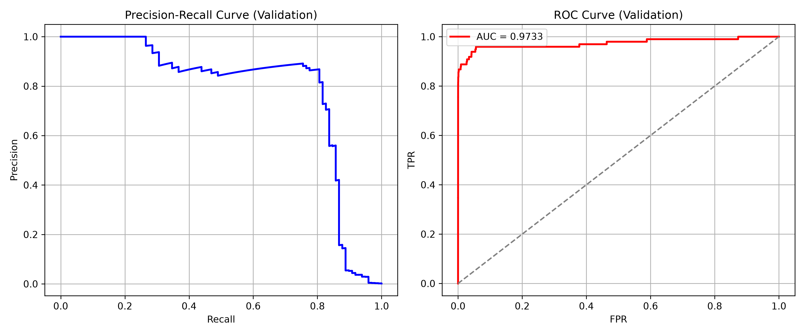

# ЛР2. Поріг рішення під асиметричну ціну помилок

## Опис задачі

Задача - виявлення шахрайства у банківських транзакціях (датасет [Credit Card Fraud Detection](https://www.kaggle.com/datasets/mlg-ulb/creditcardfraud)).

Модель (PyTorch, 2 лінійні шари) видає оцінку $s_i \in (0,1)$ - ймовірність шахрайства для кожної транзакції.  
Рішення приймається за правилом: **якщо $s_i \ge t$, прогноз = Fraud**.

Звичайний поріг $t = 0.5$ не враховує, що пропустити шахрайство коштує дорожче, ніж підняти хибну тривогу. Тому мінімізуємо функцію асиметричної вартості:
$$C(t) = 10 \cdot FN(t) + FP(t)$$

Реалізовано та порівняно два алгоритми пошуку оптимального порогу $t^*$:
- **Повільний (Slow, $O(n^2)$)** - пряме застосування матриці плутанини для кожного кандидата.
- **Швидкий (Fast, $O(n \log n)$)** - сортування та кумулятивні суми.

---

## Запуск

Завантаження датасету (одноразово):
```bash
uv run --with kagglehub python -c "
import kagglehub, shutil, pathlib
p = kagglehub.dataset_download('mlg-ulb/creditcardfraud')
src = pathlib.Path(p) / 'creditcard.csv'
dst = pathlib.Path('../data/creditcard.csv')
dst.parent.mkdir(parents=True, exist_ok=True)
shutil.copy(src, dst)
print('Done:', dst.resolve())
"
```

Команди запуску лабораторної роботи:
```bash
cd lab2

# Одноразове навчання та збереження прогнозів
uv run main.py --data ../data/creditcard.csv --out results

# Швидкий аналіз зі збережених прогнозів (без повторного навчання)
uv run main.py --saved results
```

---

## Структура проєкту

```
Lab2/
├── main.py                    # точка входу (CLI)
├── pyproject.toml
├── README.md
├── results/                   # збережені ваги, прогнози, графіки
│   ├── model.pt
│   ├── predictions.npz
│   ├── pr_roc_curves.png
│   ├── validation_candidates.csv
│   └── test_errors.csv
└── src/
    ├── lab2_starter.py        # підготовка даних та навчання PyTorch (надано викладачем)
    ├── metrics.py             # confusion_matrix, precision_recall
    ├── threshold.py           # threshold_search_slow, threshold_search_fast, verify_algorithms
    ├── toy_verifivation.py    # перевірка на наборах A, B, C
    └── analysis.py            # графіки PR/ROC, порівняльна таблиця, аналіз помилок
```

---

## Результати

### 1. Розподіл вибірок (train / validation / test)

| split | n | positives | positive_fraction |
|:---|:---|:---|:---|
| train | 170 884 | 295 | 0.001726 |
| validation | 56 961 | 98 | 0.001720 |
| test | 56 962 | 99 | 0.001738 |

**Чому `StandardScaler` навчається лише на train:**  

Статистики стандартизації: середнє $\mu$ та стандарнте відхилення $\sigma$ ($\frac{x-\mu}{\sigma}$) (для вибірок train, validation та test) не можна обчислювати на всьому наборі даних через виникнення витоку даних (data leakage). \
Якщо модель буде навчатися на вибірці train, стандартизованою за статистиками всього датасету, модель буде відчувати шуми з даних, яких не бачить для навчання. І потім при валідації та тестуванні отримаємо штучно оптимістичні результати, оскільки масштаб та середнє даних вона вже бачила під час навчання.  \
Тому правильний підхід: обчислювати $\mu_{train}$ та $\sigma_{train}$ виключно на вибірці train, після чого використовувати ці зафіксовані значення для трансформації вибірок train, validation та test.

---

### 2. Вибір порогу на Validation

**ROC-AUC = 0.9733**  
**Оптимальний поріг $t^* = 0.031194$**



| Правило | Поріг | TP | FP | FN | TN | C |
|:---|:---|:---|:---|:---|:---|:---|
| Стандартний (0.5) | 0.500 | 71 | 9 | 27 | 56 854 | **279** |
| Оптимальний ($t^*$) | 0.031 | 82 | 34 | 16 | 56 829 | **194** |
| Усі негативні (+inf) | +inf | 0 | 0 | 98 | 56 863 | **980** |

**Чому висока ROC-AUC не гарантує малої вартості чи високої точності:**  

ROC-AUC вимірює якість ранжування по всьому діапазону порогів. При сильному дисбалансі класів (~0.17% шахрайства) FPR залишається малим навіть при десятках і сотнях хибних тривог (FP), оскільки знаменник $FP + TN \approx 56\,863$ дуже великий. Тому ROC-крива виглядає відмінно (AUC = 0.9733), проте при $t = 0.5$ ми пропускаємо 27 шахрайств ($FN = 27$), що дає велику вартість $C = 279$. Оптимізація безпосередньо порогу під цільову вартість знижує її до $C = 194$.

---

### 3. Верифікація алгоритмів (Набори A, B, C + Validation)

```
Набір 'A': slow t*=0.4,  fast t*=0.4  →  PASSED ✓
Набір 'B': slow t*=inf,  fast t*=inf  →  PASSED ✓
Набір 'C': slow t*=0.8,  fast t*=0.8  →  PASSED ✓
Набір 'validation': slow t*=0.031194,  fast t*=0.031194 → PASSED ✓
```

**Що перевіряє кожен набір:**
- **A** - однакові оцінки (`0.7, 0.7`) з різними мітками: алгоритм не повинен ставити поріг між ними.
- **B** - жодного позитиву: оптимум - $t^* = +\infty$ (усі негативні, $C = 0$).
- **C** - 11 однакових оцінок `0.5`, два мінімуми вартості: правило нічиєї обирає більший поріг.

---

### 4. Тестова оцінка та аналіз помилок

Поріг $t^* = 0.031194$, зафіксований на validation, без змін застосовано до тестової вибірки. Результати test не використовувалися для зміни порога, моделі чи налаштувань навчання.

| Прогноз / Істина | Прогноз: шахрайство | Прогноз: легітимна |
|:---|:---|:---|
| **Шахрайство (99)** | $TP = 80$ | $FN = 19$ |
| **Легітимна (56 863)** | $FP = 43$ | $TN = 56\,820$ |

$$C = 10 \cdot 19 + 43 = 233$$
$$\text{Precision} = \frac{80}{80 + 43} \approx 0.6504 \quad (65.0\%)$$
$$\text{Recall} = \frac{80}{80 + 19} \approx 0.8081 \quad (80.8\%)$$

**Визначеність метрик:** 

Precision не визначена у випадку $TP + FP = 0$ (коли модель не прогнозує жодного позитиву, наприклад при $t = +\infty$). Recall не визначена у випадку $TP + FN = 0$ (коли у вибірці немає жодного справжнього позитивного об'єкта, як у наборі B).

#### Перші 5 FP та 5 FN (за номером рядка CSV):

| Рядок CSV | Тип помилки | Мітка | Оцінка $s$ | $s - t^*$ | Amount |
|:---|:---|:---|:---|:---|:---|
| 460 | FP | 0 | 0.1962 | +0.1650 | 2.00 |
| 2961 | FP | 0 | 0.0810 | +0.0498 | 2.49 |
| 10497 | FN | 1 | 0.0115 | -0.0197 | 3.79 |
| 10783 | FP | 0 | 0.9663 | +0.9351 | 89.99 |
| 13405 | FP | 0 | 0.9320 | +0.9008 | 89.99 |
| 13617 | FP | 0 | 0.9228 | +0.8916 | 89.99 |
| 52521 | FN | 1 | 0.0064 | -0.0248 | 105.99 |
| 55401 | FN | 1 | 0.0056 | -0.0256 | 1.00 |
| 91671 | FN | 1 | 0.0005 | -0.0307 | 290.18 |
| 93486 | FN | 1 | 0.0184 | -0.0128 | 0.00 |

**Аналіз помилок:**
1. **Порівняння Amount та відстані від порогу:**  
   Сирі значення Amount в обох групах різнорідні: серед FP зустрічаються як невеликі суми (2.00, 2.49), так і три однакові суми 89.99; серед FN суми варіюються від 0.00 до 290.18. Чіткого розділення за сумою між FP та FN немає.  
   Натомість відстань оцінок від порогу суттєво відрізняється: 3 із 5 FP мають оцінки $0.92–0.97$ (модель надто впевнено помилилася, зміна порогу їх не виправить). Усі 5 прикладів FN мають оцінки в діапазоні $0.0005–0.0184$, що значно нижче за $t^* = 0.0312$.
2. **Чи можна за 10 прикладами судити про причини помилок:**  
   Ні. Вибірка з 10 прикладів є замалою і невипадковою (це лише перші помилки за порядком у файлі CSV). Для статистично обґрунтованих висновків потрібно аналізувати всі 62 помилки ($43 FP + 19 FN$) і зіставляти їх із розподілом ознак $V1–V28$.
3. **Що змінив вибір порогу:**  
   Зниження порогу з $0.5$ до $0.031194$ дозволило скоротити пропущені шахрайства на validation з 27 до 16, а на test виявити 80 з 99 шахрайств ($Recall \approx 80.8\%$). Ціною цього стало збільшення хибних тривог ($FP = 43$), однак з урахуванням вартості $C = 10 \cdot FN + FP$ сукупні втрати знизилися. На test результат ($C = 233$) трохи гірший, ніж на validation ($C = 194$), що є природним явищем, адже поріг обирався на основі validation.

---

## Висновки

1. Вибір порогу $t^* = 0.031$ замість стандартного $t = 0.5$ зменшив загальну вартість помилок з **279 до 194** на validation (зниження на 30%). Ключова причина: пропущене шахрайство штрафується в 10 разів сильніше, тому вигідніше збільшити FP (хибні тривоги) заради зниження FN (пропущених шахрайств).

2. На test вартість склала $C = 233$, що гірше ніж на validation (194) - це очікувано, бо поріг підбирався на validation. Різниця підтверджує: validation не гарантує такого самого результату на test.

3. ROC-AUC = 0.97 є хорошим індикатором якості ранжування, але сам по собі не оптимізує функцію $C$. Для задач з асиметричними штрафами потрібен явний підбір порогу.


ШІ (Gemini 3.8 flash) використовувався для:
- Пояснення інтуїції за алгоритмами.
- Рефакторингу коду.
- Редагування README.md.